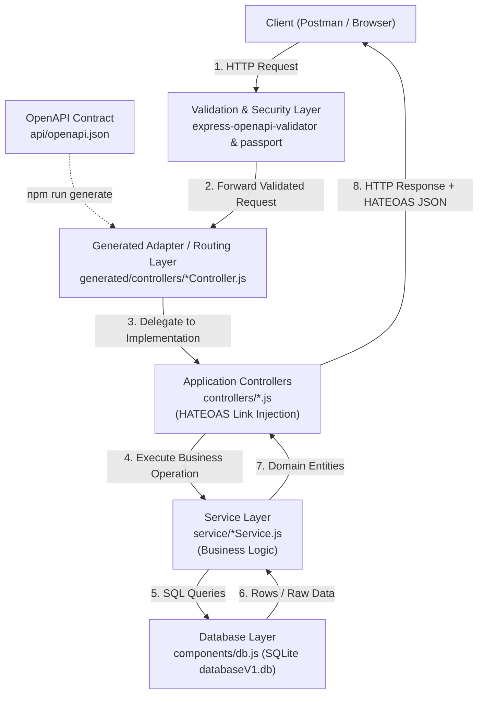

# Film Manager API

RESTful API backend for the Film Manager service, developed for the **Distributed Systems Programming** course at Politecnico di Torino.

The service provides film management, reviews assignments, user authentication, and pagination, following REST architectural principles and **HATEOAS**. The API design adopts a **contract-first** approach centered around an OpenAPI 3.0 specification.

---

## Architecture & Request Flow

The application is structured into clearly separated layers, designed around a **contract-first** approach:



### Layer Responsibilities

1. **OpenAPI Contract (`api/openapi.json`)**:
   - Single source of truth defining routes, HTTP methods, parameters, request/response schemas, and security requirements (`cookieAuth`).
   - Used by `openapi-generator-cli` with custom Mustache templates (`openapi-templates/`) to generate the routing stubs.

2. **Generated Adapter Layer (`generated/`)**:
   - Automatically generated code that acts as a bridge between the Express router / OpenAPI Validator and the actual business implementation.
   - Maps each OpenAPI `operationId` to the matching controller function.
   - *Note*: This folder is generated automatically (`npm run generate`) and should never be modified manually.

3. **Validation & Security Layer (`express-openapi-validator` + `passport-config.js`)**:
   - Intercepts requests before reaching controllers.
   - Validates request payloads and query parameters against the OpenAPI schema.
   - Validates cookie-based sessions for protected endpoints via Passport (`cookieAuth`).

4. **Controllers Layer (`controllers/`)**:
   - Receives the request from the generated adapter layer.
   - Handles HTTP-level concerns: status codes, response headers, parameter unpacking.
   - Enriches data with **HATEOAS** links (`self`, related resources, and RFC 5988 pagination links) using `controllers/link.js`.
   - Sends the formatted JSON payload to the client via `utils/writer.js`.

5. **Service Layer (`service/`)**:
   - Implements the core business logic, independent of HTTP concepts (does not access `req` or `res`).
   - Enforces domain rules, checks permissions, and handles application logic.
   - Interacts with the database layer and transforms raw rows into domain models.

6. **Database Layer (`components/db.js` & `database/databaseV1.db`)**:
   - SQLite persistent storage with foreign keys enabled (`PRAGMA foreign_keys = ON;`).
   - Executes parameterized SQL queries and handles low-level data access.

---

## Features

- **Contract-First API**: The REST interface is defined in `api/openapi.json` and converted into an Express routing layer using [OpenAPI Generator](https://openapi-generator.tech/).
- **Multi-Tier Separation**: Decoupled Adapter, Controller, Service, and Database tiers for maintainability and testability.
- **Session-Based Authentication**: Secure authentication using Passport.js (`local` strategy with salted bcrypt hashes) and Express sessions.
- **HATEOAS Compliant**: Hypermedia links embedded in responses (`self`, related resources, and RFC 5988-compliant pagination controls: `first`, `prev`, `next`, `last`).
- **Validation**: Schema-based request body validation using JSON Schema Draft-7 and Ajv.
- **Interactive Documentation**: Integrated Swagger UI available at runtime.

---

## Project Structure

```text
├── api/
│   └── openapi.json          # OpenAPI 3.0 contract specification
├── components/               # Data models and SQLite database connection
├── controllers/              # Application controllers and HATEOAS link injection
│   ├── Api.js
│   ├── Films.js
│   ├── Reviews.js
│   ├── Users.js
│   └── link.js               # HATEOAS link generator
├── database/
│   ├── databaseV1.db         # SQLite database file
│   └── passwords_databases.txt # Test accounts credentials
├── json-schemas/             # JSON Schemas (Draft-7) for request validation
├── openapi-templates/        # Custom Mustache templates for OpenAPI generator
├── service/                  # Business logic and database access layer
├── utils/                    # Helper utilities, constants, response writer
├── generated/                # Auto-generated adapter/routing layer (do not edit)
├── index.js                  # Express application entry point
├── passport-config.js        # Passport local strategy configuration
└── package.json
```

---

## Prerequisites

- **Node.js** (v20 or v22 recommended)
- **npm** (bundled with Node.js)
- **Java** (JRE 11+ or 17+, required by `@openapitools/openapi-generator-cli`)

---

## Installation & Setup

1. **Clone the repository:**
   ```bash
   git clone https://github.com/sdoublesm/dsp-film-manager.git
   cd dsp-film-manager
   ```

2. **Install dependencies:**
   ```bash
   npm install
   ```

3. **Generate the adapter / routing layer:**
   The routing layer is generated from `api/openapi.json` into the `generated/` folder:
   ```bash
   npm run generate
   ```
   > **Note:** Run `npm run generate` every time you modify `api/openapi.json`.

---

## Running the Application

Start the Express server:

```bash
npm start
```

The service will run at:
- **API Base URL**: `http://localhost:3001`
- **Interactive Swagger UI**: `http://localhost:3001/docs`

---

## Authentication & Test Credentials

The API protects private resources using cookie-based session authentication (`cookieAuth`).

To authenticate, send a `POST` request to `/api/users/authenticator` with a JSON payload:

```json
{
  "email": "user.dsp@polito.it",
  "password": "password"
}
```

### Pre-configured Test Accounts

| Email | Password | Name |
| :--- | :--- | :--- |
| `user.dsp@polito.it` | `password` | User |
| `frank.stein@polito.it` | `shelley97` | Frank |
| `karen.makise@polito.it` | `fg204v213` | Karen |
| `rene.regeay@polito.it` | `historia` | Rene |
| `beatrice.golden@polito.it` | `seagulls` | Beatrice |
| `arthur.pendragon@polito.it` | `holygrail` | Arthur |

Full database credentials can also be found in `database/passwords_databases.txt`.

---

## Configuration

- **Pagination**: The number of elements per page can be configured in `utils/constants.js` via the `ELEMENTS_IN_PAGE` constant.
- **Port**: The default listening port is `3001` (configured in `index.js`).
