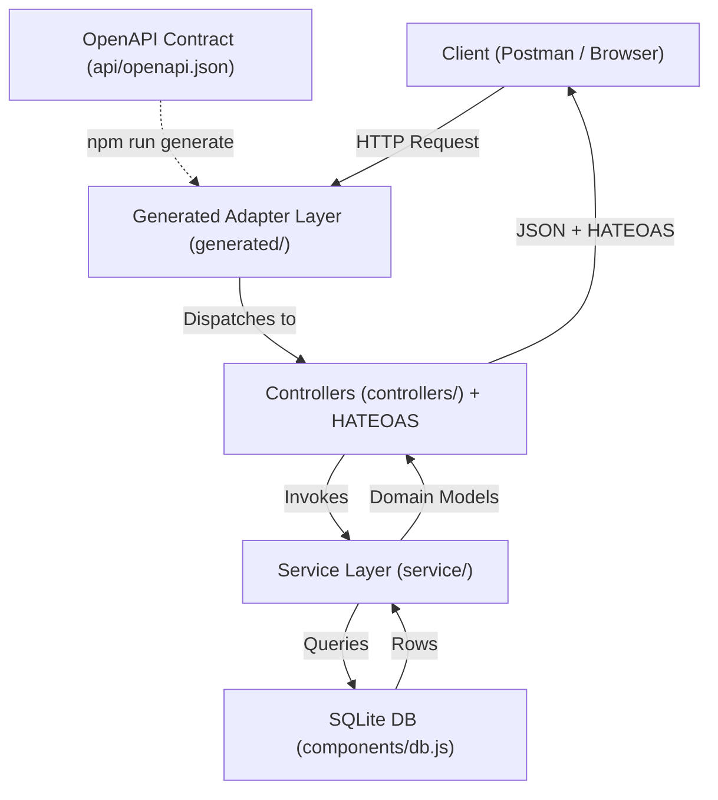

# Film Manager API

RESTful API backend for the Film Manager service developed for the **Distributed Systems Programming** course at Politecnico di Torino. The service follows REST and **HATEOAS** principles with a **contract-first** architecture based on OpenAPI 3.0.

## Architecture & Request Flow



- **OpenAPI Contract (`api/openapi.json`)**: Defines endpoints, parameters, schemas, and security (`cookieAuth`).
- **Adapter Layer (`generated/`)**: Auto-generated by OpenAPI Generator; bridges incoming routes to the matching controller functions.
- **Controllers (`controllers/`)**: Handles HTTP requests/responses, validates payloads, and injects **HATEOAS** links (`controllers/link.js`).
- **Services (`service/`)**: Implements business logic and domain rules, completely decoupled from HTTP concerns.
- **Database (`components/db.js`)**: Executes parameterized SQL queries on SQLite (`database/databaseV1.db`).

## Project Structure

```text
├── api/                  # OpenAPI 3.0 specification
├── components/           # Models and SQLite DB connection
├── controllers/          # HTTP controllers and HATEOAS link generator
├── database/             # SQLite database and test credentials
├── json-schemas/         # Draft-7 JSON schemas for validation
├── openapi-templates/    # Mustache templates for OpenAPI Generator
├── service/              # Core business logic
├── utils/                # Constants and response writer
├── generated/            # Auto-generated adapter layer (do not edit)
├── index.js              # Server entry point
└── passport-config.js    # Passport local strategy
```

## Quick Start

### Prerequisites
- Node.js (v20+)
- npm
- Java (JRE 11+, required for OpenAPI Generator)

### Setup & Run
```bash
# 1. Install dependencies
npm install

# 2. Generate adapter layer (run every time api/openapi.json changes)
npm run generate

# 3. Start server
npm start
```

- **Server**: `http://localhost:3001`
- **Swagger UI**: `http://localhost:3001/docs`

## Authentication & Test Credentials

Protected endpoints use cookie-based session authentication. Authenticate via `POST /api/users/authenticator` with JSON credentials:

```json
{
  "email": "user.dsp@polito.it",
  "password": "password"
}
```

| Email | Password | Role |
| :--- | :--- | :--- |
| `user.dsp@polito.it` | `password` | User |
| `frank.stein@polito.it` | `shelley97` | User |
| `karen.makise@polito.it` | `fg204v213` | User |
| `rene.regeay@polito.it` | `historia` | User |
| `beatrice.golden@polito.it` | `seagulls` | User |
| `arthur.pendragon@polito.it` | `holygrail` | User |

*Additional accounts are listed in `database/passwords_databases.txt`.*

## Configuration

- **Pagination**: Adjust `ELEMENTS_IN_PAGE` in `utils/constants.js`.
- **Port**: Set via `serverPort` in `index.js` (default: `3001`).
